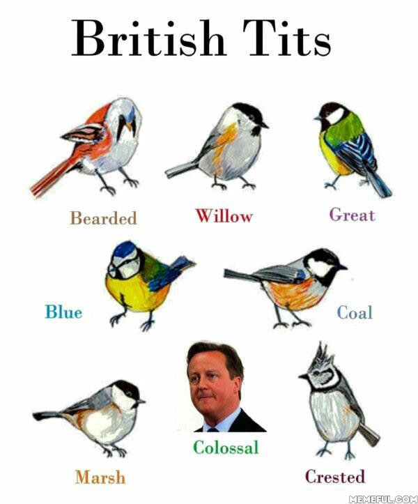

There's a feeling I get, when I look to the West, except when crane migration is underway, which is when I am usually more fond of the East. For now, no significant eastern wind has blown any cranes off-track, so I was particularly excited to head eastward to Köln. Unfortunately, I learned that Köln lies beyond the [typical western migration route](https://www.kraniche.de/en/crane-migration.html){:target="_blank" rel="noopener noreferrer"}. Indeed, barely any cranes are reported over Cologne, although I am wary of the data, which comes from a user base heavily concentrated in Belgium and The Netherlands (see below, Source: [observation.org](https://observation.org/species/19/maps/?start_date=2026-10-01&interval=86400&end_date=2026-11-05&map_type=heat){:target="_blank" rel="noopener noreferrer"} and [OpenTopoMap](https://opentopomap.org/about){:target="_blank" rel="noopener noreferrer"}).



Anyway, *Crane hunt part 2* yields no sightings, however, Cologne was still a success, with 4 new lifers! First, in central Cologne, two parakeet species live: the [Alexandrine parakeet](https://ebird.org/species/alepar2/BE){:target="_blank" rel="noopener noreferrer"} and the [rose-ringed parakeet](https://ebird.org/species/rorpar/BE){:target="_blank" rel="noopener noreferrer"}, the former of which is a new lifer to me. Their colourful presence feels off, and the pictures feel like they are taken in a zoo, because both parakeets are feral: descendants from escaped or released domesticated parakeets. Looking at it, it's obvious that it belongs in its native colourful South Asian habitat and not in the drab streets of Cologne. 



On Sunday, we took a hike in the Wahner Heide forest, which finally yielded the long-awaited sighting of the extremely cute [Eurasian treecreeper](https://ebird.org/species/eurtre1/BE){:target="_blank" rel="noopener noreferrer"}. Very similar to the more common short-toed treecreeper, it has a lighter belly, shorter bill and a different call. Pics aren't the best as light conditions weren't optimal, but together with the clear sound bits I am confident this is a *certhia familiaris*. Both occur in these parts, whereas this one does not occur in the western part of Belgium where I live. Going east was therefore not futile bird-wise.

  

    
  

  

    <audio controls preload="metadata">
      <source src="{{ '/media/2026-11-01-Köln-taiga.mp3' | relative_url }}" type="audio/mpeg">
      Your browser does not support the audio element.
    </audio>
  

Along the path there's many great spotted woodpeckers foraging, goldcrests, nuthatches and robins. About ten minutes after the treecreeper success, Merlin indicates the possible presence of a [crested tit](https://ebird.org/species/cretit2){:target="_blank" rel="noopener noreferrer"}, the punkest of tits. We are able to find it but the best picture I manage to snag is not great, so I've also included the depiction of the _Haubenmeise_ from the information panel on birds of the forest. I have since taken a (slightly) better picture of a crested tit, which I'll post shortly.



I'll gladly take this (and any) opportunity to share the following wonderful meme a user named AsherWare posted in 2016 on [imgur](https://imgur.com/gallery/brush-up-on-ornithology-60nAHCJ) (its original source is unknown, this is the earliest known appearance of its usage):

   
  The colossal tit (*parus colossus*, definitely not Linnaeus, somewhere 2016-ish) is one of the most destructive of the tit species on the British Isles, known for its crushing of hopes and dreams through its frequent media appearances and conservative policies. Its largest single-event impact thus far is the shrinkage of the UK's GDP by at least 6%.¹

¹ [Bloom *et al.*, *The Economic Impact of Brexit*](https://siepr.stanford.edu/publications/working-paper/economic-impact-brexit)

